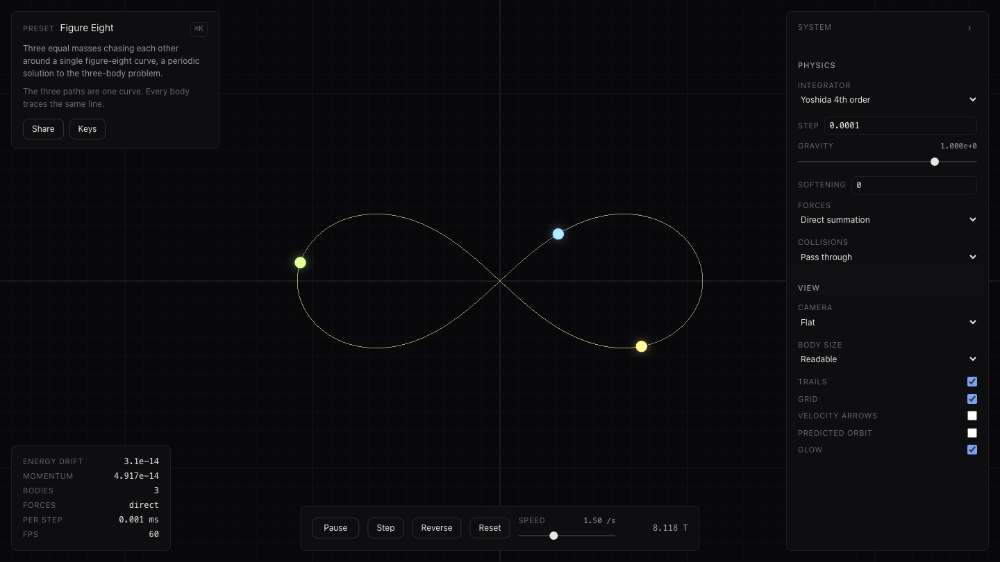
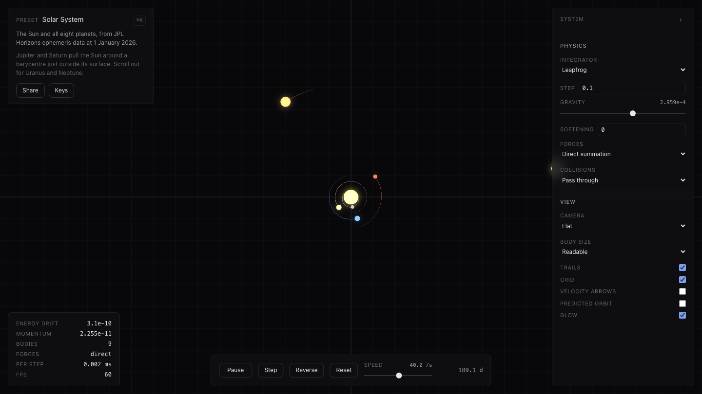
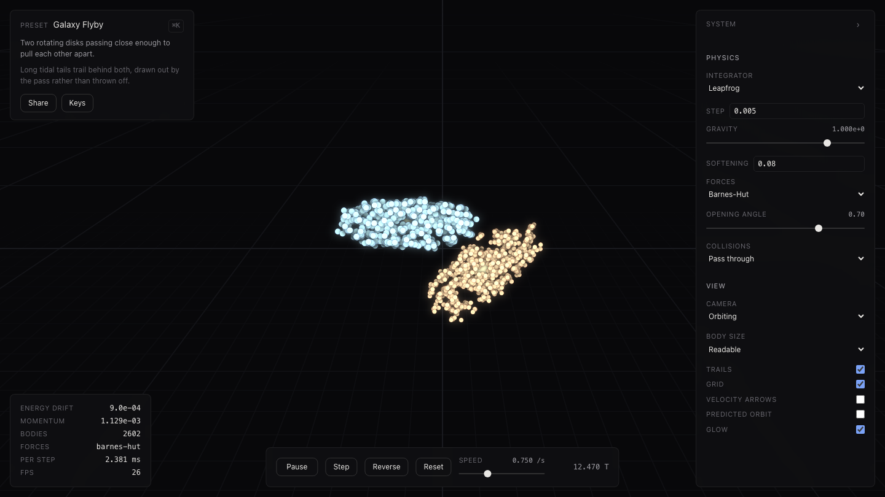

# N-Body

An interactive gravitational simulator. Watch the real solar system, a periodic
three-body orbit, or two galaxies tearing each other apart. Then change
anything you like while it runs.

### [Open it →](https://devashishbhat.github.io/Nbody/)



## What you can do

**Watch twenty systems.** The Sun and all eight planets, from real JPL Horizons
ephemeris data. Earth and the Moon. Jupiter with the four moons Galileo saw.
Nine periodic solutions to the three-body problem, including Lagrange's
equilateral triangle and the figure-eight above. Star clusters, a cold
collapse, Jupiter's Trojan asteroids, and a galaxy flyby of 2,602 bodies.

**Change the physics while it runs.** Nothing restarts. Drag a planet to a new
orbit, grab the tip of its velocity arrow and aim it somewhere else, or hold shift and drag empty space to sling a new body into the system. Set gravity itself to
something it has never been. Make Jupiter a thousand times heavier and watch
the inner planets lose their orbits.

**See whether it is still true.** The energy drift readout tells you how far
the simulation has strayed from conservation. Below 1e-9 you can trust what you
are watching; when it starts climbing, your time step is too coarse for what is
happening. The selected body shows its live orbital elements, which breathe as
you perturb it.

**Share what you made.** Any system compresses into the URL. No account, no
server, no database.





## Controls

Press `?` in the app for the full list. The short version:

| | |
| --- | --- |
| Drag | Move the view. Two-finger scroll on a trackpad. |
| Scroll / pinch | Zoom where the pointer is |
| Click a body | Select it |
| Drag a body | Move it |
| Drag the arrow tip | Change its velocity |
| Shift + drag | Sling a new body into the system |
| `⌘K` | Every preset and command |
| `Space` | Play or pause |
| `D` | Flat or orbiting camera |

## How it works

Physics runs in a Web Worker at a fixed step. The main thread renders at a
fixed lag behind the newest frame and interpolates with cubic Hermite splines,
using the velocities each frame carries, so a stutter in the simulation never
reaches the screen. Frame buffers are transferred and recycled rather than
copied, so a running simulation allocates nothing on either thread.

Rendering is hand-written WebGL2. Forces use direct summation up to about two
thousand bodies and a Barnes-Hut octree above that. Three integrators: leapfrog
by default, Yoshida 4 for accuracy, and adaptive Dormand-Prince for close
encounters, where a fixed step is not merely less accurate but gives a
different answer.

Every preset holds 60 fps.

## Is the physics real?

Yes, and it is tested rather than asserted.

The integrators are checked against closed-form solutions: order of
convergence, bounded symplectic energy error, exact momentum conservation, and
time reversal retracing its own path. Barnes-Hut is checked against direct
summation. Every periodic orbit is integrated for exactly one published period
and measured against where it started. The figure-eight closes to 4 parts in
100 million, a floor set by the published initial conditions rather than by
the integration.

The solar system is checked against reality. Earth comes out at 0.9834 AU from
the Sun moving at 30.28 km/s, and the barycentre lands just outside the Sun's
surface, which is where it actually is.

268 unit tests and 30 browser tests. [docs/PHYSICS.md](docs/PHYSICS.md) has the
numbers.

## Running it yourself

```bash
pnpm install
pnpm dev
```

```bash
pnpm verify    # format, lint, typecheck, tests
pnpm test:e2e  # browser tests, after pnpm build
pnpm bench     # engine throughput
```

Refresh the ephemeris from JPL Horizons with
`pnpm --filter @nbody/tool-horizons fetch`. The committed data is the source of
truth at runtime, so the site never calls an external API.

## Reading the source

| | |
| --- | --- |
| [CONTRACTS.md](docs/CONTRACTS.md) | The interfaces and rules everything is built on |
| [ARCHITECTURE.md](docs/ARCHITECTURE.md) | Thread model, package layout, why these choices |
| [PHYSICS.md](docs/PHYSICS.md) | Integrators, force models, units, verified results |
| [DESIGN.md](docs/DESIGN.md) | Visual language, layout, how scale is handled |

```
packages/protocol     the shared contract: types, schema, frame layout, orbits
packages/engine       worker, client, interpolation, the physics engine
packages/renderer     WebGL2 and the camera
packages/scenarios    presets, generators, share-link codec
packages/ui           design tokens and controls
apps/web              the application
```

## Licence

MIT. See [LICENSE](LICENSE).

Solar system state vectors come from [JPL Horizons](https://ssd.jpl.nasa.gov/horizons/).
The periodic three-body orbits are from Šuvakov and Dmitrašinović's 2013
catalogue and the Chenciner and Montgomery figure-eight.
